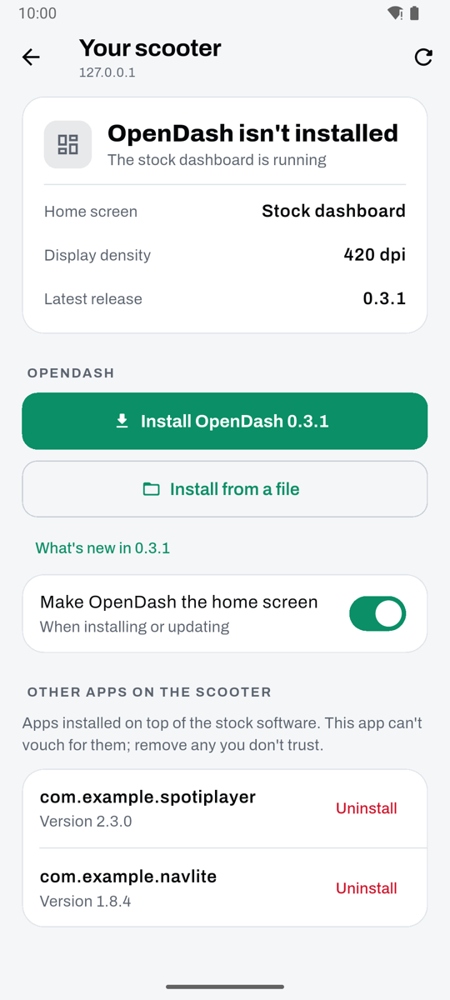
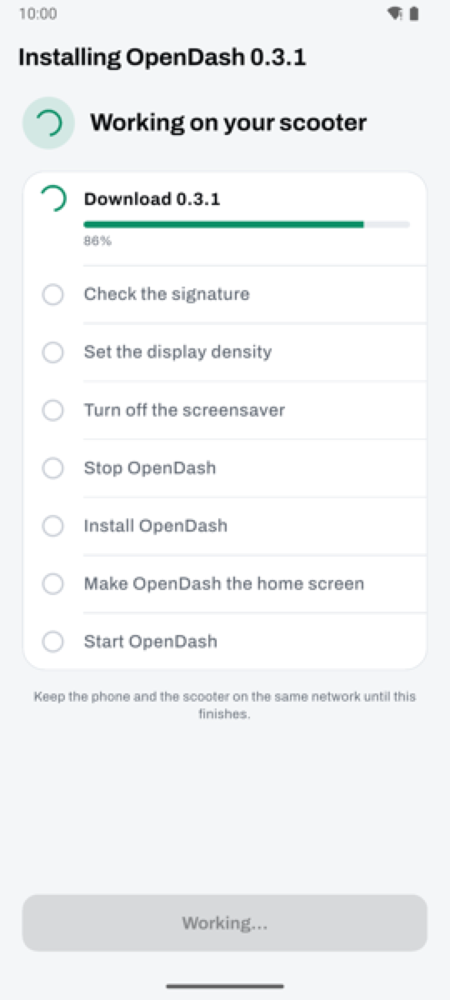
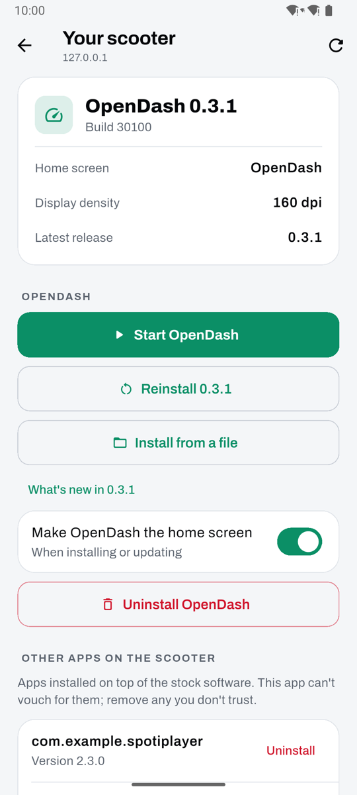
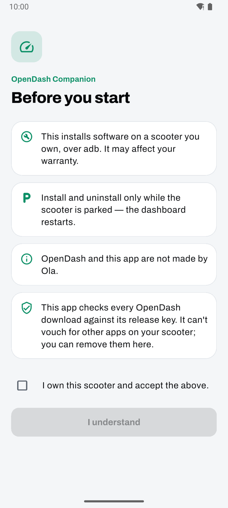
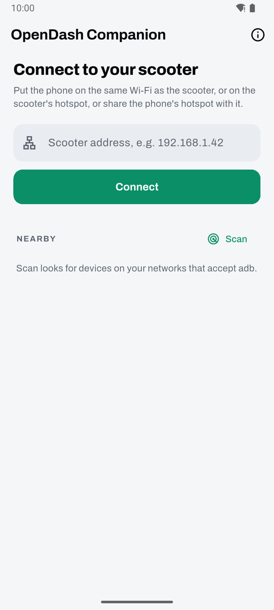
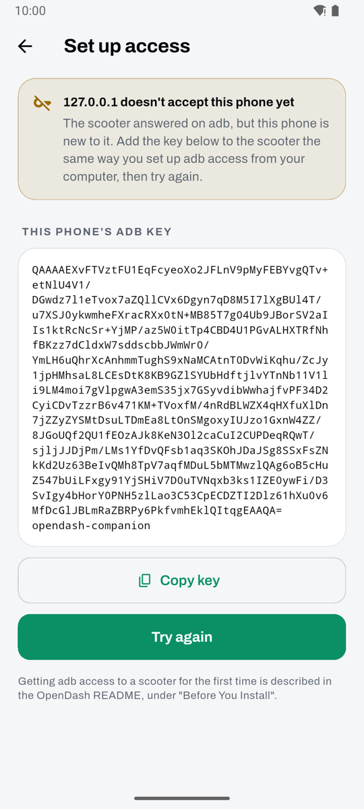
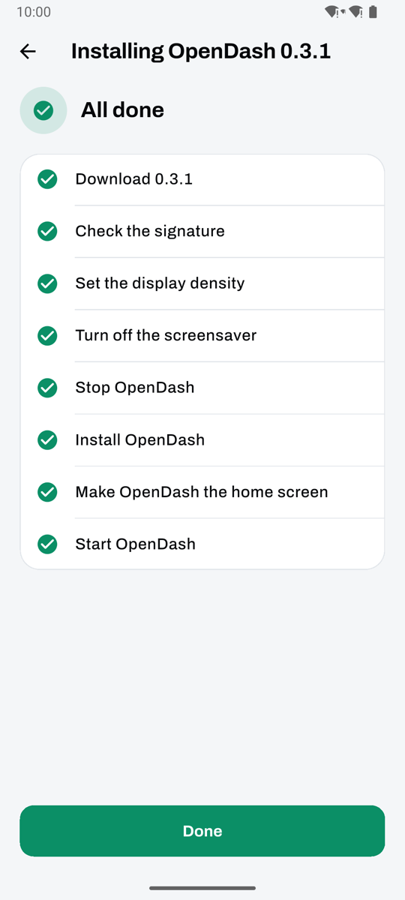

<p align="center">
  
</p>
<h1 align="center">OpenDash Companion</h1>
<p align="center">Install, update and remove OpenDash on an Ola S1 scooter from your phone</p>
<div align="center">
  <a href="https://github.com/abhijithvijayan/opendash-companion/blob/main/license">
    
  </a>
  <a href="https://github.com/abhijithvijayan/opendash-companion/releases/latest">
    
  </a>
  <a href="https://github.com/abhijithvijayan/opendash-companion/actions/workflows/ci.yml">
    
  </a>
  <a href="https://twitter.com/intent/tweet?text=Check%20out%20OpenDash%20Companion%21%20by%20%40_abhijithv%0A%0AInstall%20OpenDash%20on%20your%20Ola%20S1%20from%20your%20phone%0Ahttps%3A%2F%2Fgithub.com%2Fabhijithvijayan%2Fopendash-companion%0A%0A%23OlaS1Pro%20%23EV%20%23Flutter">
     
  </a>
</div>
<h3 align="center">Made by <a href="https://twitter.com/_abhijithv">@abhijithvijayan</a></h3>
<p align="center">
  Donate:
  <a href="https://www.paypal.me/iamabhijithvijayan" target='_blank'><i><b>PayPal</b></i></a>,
  <a href="https://www.patreon.com/abhijithvijayan" target='_blank'><i><b>Patreon</b></i></a>
</p>
<p align="center">
  <a href='https://www.buymeacoffee.com/abhijithvijayan' target='_blank'>
    
  </a>
</p>
<hr />

<p align="center">
  
  
  
</p>

> **OpenDash Companion is an independent community project. It is not made, endorsed or supported by Ola Electric.** Read the [disclaimer](#disclaimer) before you use it.

## Table of Contents

- [What This Is](#what-this-is)
- [Features](#features)
- [Screenshots](#screenshots)
- [Before You Start](#before-you-start)
- [Installing](#installing)
- [Updating](#updating)
- [Privacy](#privacy)
- [Building from Source](#building-from-source)
- [Releasing](#releasing)
- [Related Projects](#related-projects)
- [Issues](#issues)
- [Disclaimer](#disclaimer)
- [Trademarks](#trademarks)
- [License](#license)

## What This Is

[OpenDash](https://github.com/abhijithvijayan/opendash) is an open-source replacement dashboard for Ola S1 scooters. Installing it from a computer means adb and a terminal. OpenDash Companion is an Android phone app that does the same job over the scooter's own network: no laptop, no command line.

## Features

- **Finds the scooter** on your Wi-Fi, on the scooter's hotspot, or on your phone's hotspot. You can also type its address.
- **Installs or updates OpenDash** from its GitHub releases. Every download is checked against the release's checksum and OpenDash's release signing key before it goes anywhere near the scooter. It then sets the display density, makes OpenDash the home screen (optional) and starts it.
- **Tells you about updates** each time you open it, with the release notes. You can skip a version.
- **Installs from a file** too, for builds you made yourself. It warns you when an APK isn't signed with the release key.
- **Uninstalls OpenDash**, giving the home screen back to the stock dashboard and resetting the display density.
- **Shows the other apps** installed on the scooter on top of the stock software, and lets you remove any you don't trust.
- **Refuses anything that isn't an Ola head unit**, so it can't change the wrong device.
- **Updates itself** from this repository's releases, through Android's own installer.
- **Helps you report a problem**: **Share logs** lets you pick this app's log, OpenDash's own log and the CAN bus recordings from the scooter, zips them and opens the share sheet; **Report a problem** opens a GitHub issue with the versions filled in.

## Screenshots

| | | |
|:---:|:---:|:---:|
| <br />Before you start | <br />Find the scooter | <br />First time: this phone's adb key |
| <br />Your scooter and the apps on it | <br />Every step, checked | <br />Installed, ready to update or remove |

## Before You Start

- **The app sets up access for you, the first time.** If the scooter doesn't yet trust this phone, the app adds the phone's adb key over the scooter's own diagnostics service and sets the scooter to `mfg` mode, which opens its diagnostics ports (the documented mechanism). No laptop and no copying keys by hand. It isn't guaranteed on every scooter: on some MoveOS 4 builds the diagnostics service doesn't allow it, and the app says so. Those scooters need OpenDash side-loaded manually instead; see [Before You Install](https://github.com/abhijithvijayan/opendash#before-you-install) in the OpenDash README.
- **Install and uninstall only while the scooter is parked.** The dashboard restarts.
- **This may affect your warranty.** See the [disclaimer](#disclaimer).

## Installing

1. **Get the app, once.** It isn't on the Play Store: on an Android phone (Android 10 or later), download `opendash-companion-<version>.apk` from the [latest release](https://github.com/abhijithvijayan/opendash-companion/releases/latest) and open it. Android asks once to allow installs from your browser. From then on the app updates itself.
2. Put the phone on the same Wi-Fi as the scooter, on the scooter's hotspot, or share the phone's hotspot with the scooter.
3. Open the app, tap **Scan** (or type the scooter's address) and connect.
4. With the scooter parked, tap **Install OpenDash**. You never download OpenDash yourself: the app fetches the latest release from GitHub, checks it and installs it.

Every release is signed with the same key. You can check a download with `apksigner verify --print-certs opendash-companion-<version>.apk`; the certificate's SHA-256 is given in each release's notes.

## Updating

The app checks for a new OpenDash and a new version of itself each time you open it. Updating itself goes through Android's installer, and it only accepts an APK signed with its own release key.

## Privacy

The app talks only to your scooter and to GitHub (`api.github.com` and the release downloads). It sends nothing about you, your phone or your scooter, and has no analytics, crash reporting or account. Its log stays on the phone; it leaves only when you share it.

## Building from Source

OpenDash Companion is a Flutter app with a small Kotlin layer for adb.

```bash
flutter pub get
flutter analyze
flutter test
flutter build apk --debug
```

The adb layer is generated from `pigeons/adb_api.dart`:

```bash
dart run pigeon --input pigeons/adb_api.dart
```

A debug build can't update itself (it isn't signed with the release key) and can't be installed over a release build, or the reverse. Uninstall first when switching between them.

## Releasing

1. Set `version:` in `pubspec.yaml`, commit and push to `main`.
2. Tag it: `git tag v0.1.0 && git push origin v0.1.0`, or run the Release workflow by hand on `main`.
3. The [Release workflow](.github/workflows/release.yml) runs the tests, then [`scripts/release.sh`](scripts/release.sh) with the signing key from the `release` environment. The script refuses to build when the APK's certificate isn't `COMPANION_CERT_SHA256`. The workflow leaves a **draft** release with the APK and `companion-release.json`.
4. Read the draft, edit its notes, publish. Installed copies see the update only once it is published.

The same script builds a release locally, with the key in `android/key.properties`.

## Related Projects

- [**OpenDash**](https://github.com/abhijithvijayan/opendash): the dashboard this app installs
- [**ola-s1-pro-gen1**](https://github.com/abhijithvijayan/ola-s1-pro-gen1): research notes and access tools for the Gen 1 head unit
- [**OlaMate**](https://github.com/abhijithvijayan/olamate): battery health and ride telemetry logger

## Issues

_Looking to contribute? Look for the [Good First Issue](https://github.com/abhijithvijayan/opendash-companion/issues?q=is%3Aissue+is%3Aopen+sort%3Aupdated-desc+label%3A%22good+first+issue%22) label._

### 🐛 Bugs

In the app, **Report a problem** (on the scooter screen) opens a new issue with the versions filled in, on this repository or on [OpenDash](https://github.com/abhijithvijayan/opendash/issues)'s, and **Share logs** gives you a zip to attach. Both are also in **About**, for when the app can't connect at all.

Or file an issue [here](https://github.com/abhijithvijayan/opendash-companion/issues/new) for bugs, missing documentation, or unexpected behavior. Say which phone and Android version you have, the app's version (in About), and which scooter.

[**See Bugs**](https://github.com/abhijithvijayan/opendash-companion/issues?q=is%3Aissue+is%3Aopen+sort%3Aupdated-desc+label%3Abug)

## Disclaimer

OpenDash Companion is provided **as is**, without warranty of any kind, and you use it **entirely at your own risk**.

- It is an independent, free and open-source community project. It is not made, endorsed, sponsored or supported by Ola Electric Mobility Ltd. or any of its affiliates.
- It needs adb access to your scooter's head unit, which the manufacturer does not offer. Getting that access, or installing a third-party dashboard, may void your warranty, and the manufacturer or its service centres may refuse support while it is installed.
- Use it only on a scooter you own, or with the owner's permission, and only while the scooter is parked.
- The authors and contributors are not liable for any damage to your scooter, injury, loss, fine, or any other consequence of using it.

It contains no code, firmware, images or fonts from Ola Electric. The font used is [Archivo](https://fonts.google.com/specimen/Archivo), under the SIL Open Font License.

## Trademarks

Ola, Ola Electric, S1 and S1 Pro are trademarks of their respective owners. They are used here only to say which scooters this app works with. That use does not imply any affiliation with or endorsement by them.

Android and Flutter are trademarks of Google LLC.

## License

Copyright © Abhijith Vijayan

OpenDash Companion is free software: you can redistribute it and/or modify it under the terms of the GNU General Public License as published by the Free Software Foundation, either version 3 of the License, or (at your option) any later version.

OpenDash Companion is distributed in the hope that it will be useful, but WITHOUT ANY WARRANTY; without even the implied warranty of MERCHANTABILITY or FITNESS FOR A PARTICULAR PURPOSE. See the [GNU General Public License](license) for more details.
